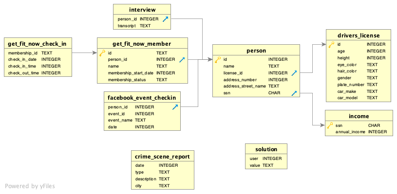

## **SITUATION:**

A crime has taken place and the detective needs your help. The detective gave you the crime scene report, but you somehow lost it. You vaguely remember that the crime was a ​murder​ that occurred sometime on ​Jan.15, 2018​ and that it took place in ​SQL City​. Start by retrieving the corresponding crime scene report from the police department’s database.

Source: [SQL Murder Mystery](https://mystery.knightlab.com/)

## **SCHEMA**



## **APPROACH**
1. **Used the initial given information**

```sql
SELECT *
FROM crime_scene_report
WHERE
    city = "SQL City"
    AND type = "murder"
    AND date = 20180115
```

2. **Looked for the witness named "Annabel"**

```sql
SELECT *
FROM person
WHERE
    address_street_name = "Franklin Ave"
    AND name LIKE = "%Annabel%"
```

3. **Looked for Annabels's interview transcript**

```sql
SELECT *
FROM person
JOIN interview
    ON interview.person_id = person.id
WHERE
    address_street_name = "Franklin Ave"
    AND name LIKE "%Annabel%"
```

4. **Since she recognized the killer from her gym, looked at her gym details**

```sql
SELECT
    person.name,
    person.id,
    membership_status,
    membership_start_date
FROM person
JOIN interview
    ON interview.person_id = person.id
JOIN get_fit_now_member
    ON get_fit_now_member.person_id = person.id
WHERE
    person.address_street_name = "Franklin Ave"
    AND perso.name LIKE "%Annabel%"
```