## **EXECUTIVE SUMMARY**
This project is based on the [SQL Murder Mystery](https://mystery.knightlab.com/). It enhanced my problem-solving and critical thinking skills using SQL for exploratory data analysis, particularly in constructing efficient queries to identify the killer, ***Jeremy Bowers***, and the mastermind, ***Miranda Priestly***.


## **SITUATION**

A crime has taken place and the detective needs your help. The detective gave you the crime scene report, but you somehow lost it. You vaguely remember that the crime was a ​murder​ that occurred sometime on ​Jan.15, 2018​ and that it took place in ​SQL City​. Start by retrieving the corresponding crime scene report from the police department’s database.

## **SCHEMA**


## **APPROACH**
1. **Used the initial information**

```sql
SELECT *
FROM crime_scene_report
WHERE
    city = "SQL City"
    AND type = "murder"
    AND date = 20180115
```
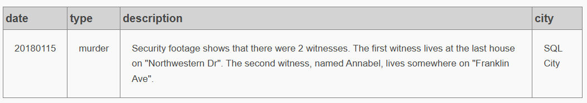

2. **Looked for the witness named "Annabel"**

```sql
SELECT *
FROM person
WHERE
    address_street_name = "Franklin Ave"
    AND name LIKE   "%Annabel%"
```
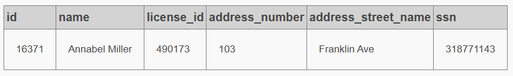

3. **Looked for Annabels's interview transcript**

```sql
SELECT
    id,
    name,
    address_street_name,
    transcript
FROM person
JOIN interview
    ON interview.person_id = person.id
WHERE
    address_street_name = "Franklin Ave"
    AND name LIKE "%Annabel%"
```
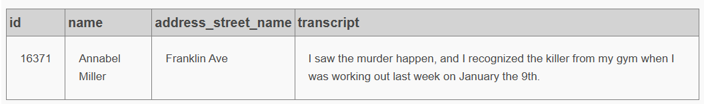

4. **Since she recognized the killer from her gym, looked at her gym details**

```sql
SELECT
    person.name,
    person.id,
    membership_status,
    membership_start_date
FROM person
JOIN interview
    ON interview.person_id = person.id
JOIN get_fit_now_member
    ON get_fit_now_member.person_id = person.id
WHERE
    person.address_street_name = "Franklin Ave"
    AND person.name LIKE "%Annabel%"
```
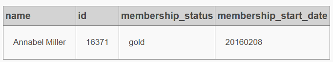

5. **She saw the killer when she was working out on January 19th**

```sql
SELECT
    person_id,
    name,
    membership_status,
    check_in_time,
    check_out_time
FROM get_fit_now_check_in
JOIN get_fit_now_member
    ON get_fit_now_member.id = get_fit_now_check_in.membership_id
WHERE
    membership_status = "gold"
    AND check_in_date IN (20170109, 20180109)
    AND check_in_time < 1700 -- check-in must be before Annabel leaves
    AND check_out_time > 1600 -- check-out must be after Annabel enters
ORDER BY get_fit_now_check_in.check_in_date
```
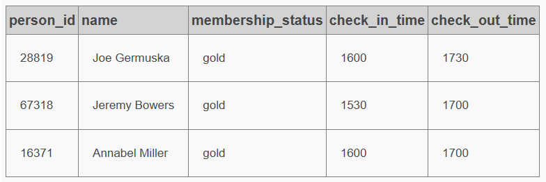

6. **Looked for the interview transcript of the 2nd witness**

```sql
SELECT
    id,
    name,
    address_number,
    address_street_name,
    transcript
FROM person
JOIN interview
    ON interview.person_id = person.id
WHERE 
    address_street_name = "Northwestern Dr"
ORDER BY address_number DESC
LIMIT 1
```
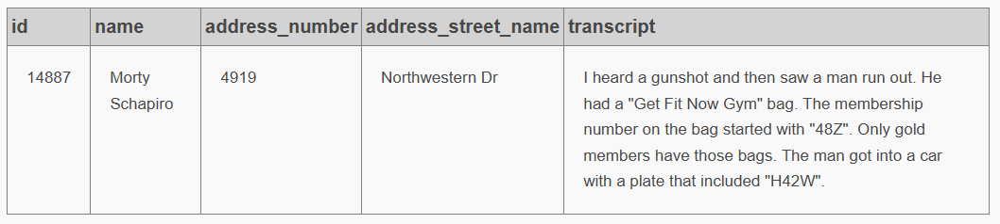

7. **Checked the given plate number and membership status of the suspect**

```sql
WITH suspect AS (
    SELECT
        person_id AS person_id,
        membership_id AS membership_id,
        name AS person_name,
        membership_status AS membership
    FROM get_fit_now_check_in
    JOIN get_fit_now_member
        ON get_fit_now_member.id = get_fit_now_check_in.membership_id
    WHERE 
        membership_id LIKE "%48Z%"
        AND membership_status = "gold"
)
SELECT
    person_id,
    membership_id,
    person_name,
    membership,
    plate_number
FROM suspect
JOIN person
    ON suspect.person_id = person.id
JOIN drivers_license
    ON person.license_id = drivers_license.id

```
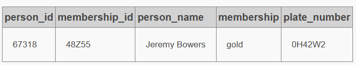

8. **Verified if the killer had already been identified**

```sql
INSERT INTO solution VALUES (1, "Jeremy Bowers");
SELECT values FROM solution;
```

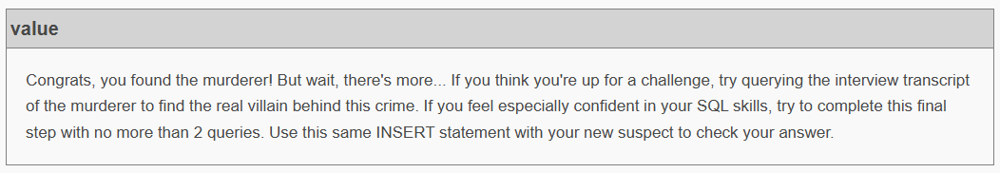

9. **Now, check for the mastermind according to ther killer**

```sql
SELECT *
FROM interview
WHERE person_id = 67318
```
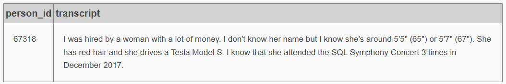

10. **The mastermind based on killer's transcript**

```sql
WITH mastermind AS (
    SELECT
    person.id AS person_id,
    person.name AS person_name,
    person.license_id AS person_license_id,
    CAST(facebook_event_checkin.date AS TEXT) AS event_date
FROM person
JOIN facebook_event_checkin
    ON person.id = facebook_event_checkin.person_id
WHERE
    facebook_event_checkin.event_name = "SQL Symphony Concert"
    AND date LIKE "201712%"
)

SELECT
    person_id,
    person_name,
    drivers_license.height,
    drivers_license.hair_color,
    drivers_license.car_make,
    drivers_license.car_model
FROM mastermind
JOIN drivers_license
    ON drivers_license.id = mastermind.person_license_id
GROUP BY
    person_id,
    person_name
HAVING 
    COUNT(person_id) = 3
```
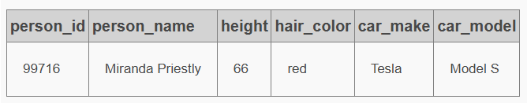

11. **Verified if I found the mastermind**

```sql
INSERT INTO solution VALUES (1, "Miranda Priestly")
SELECT value FROM solution;
```

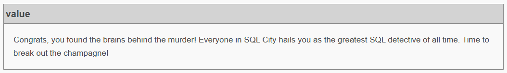
